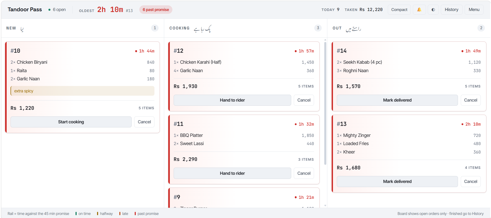
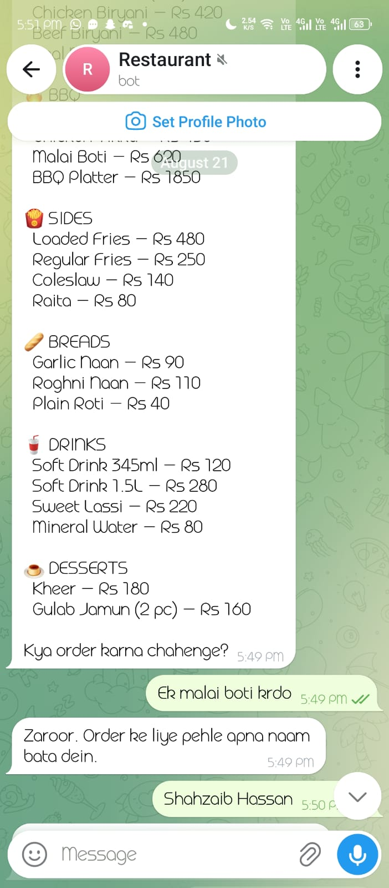
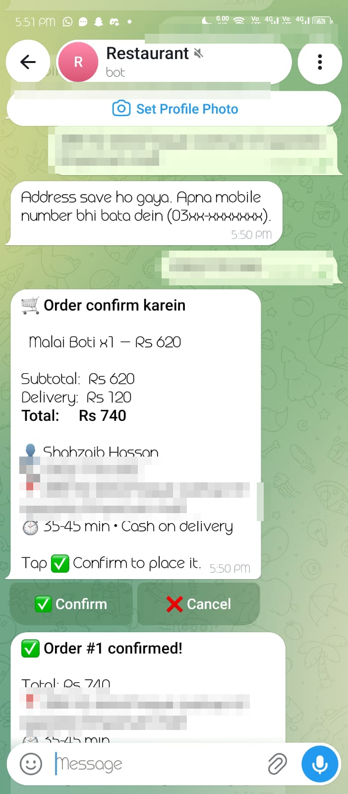
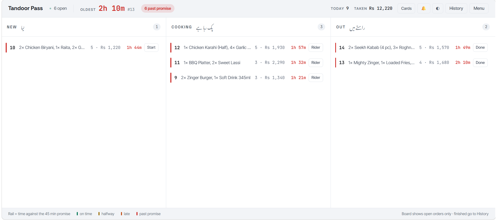
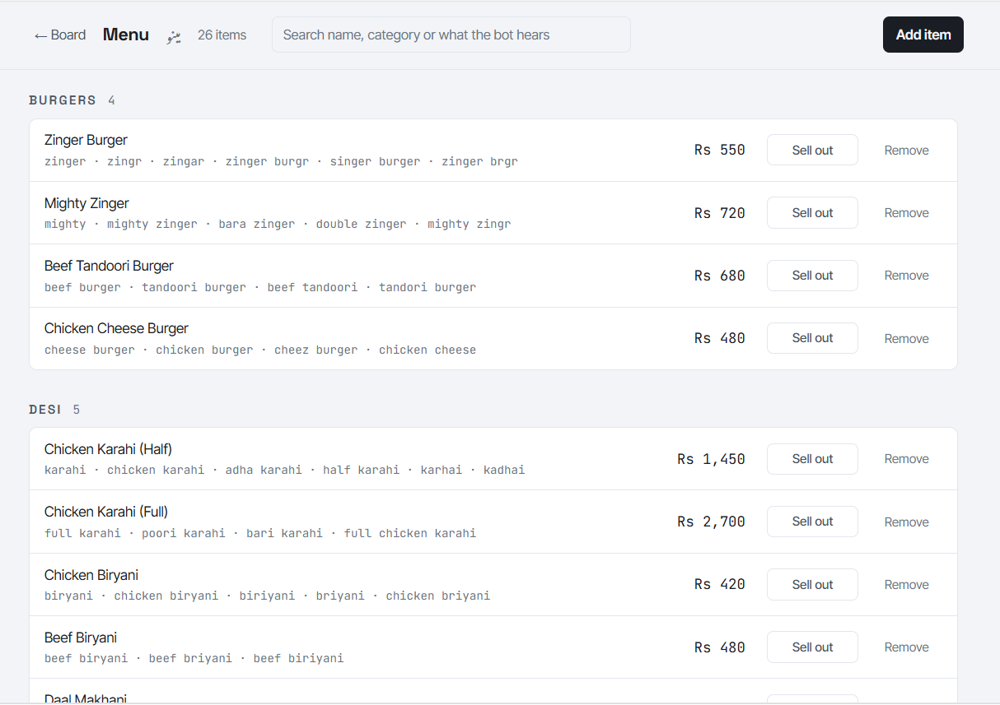
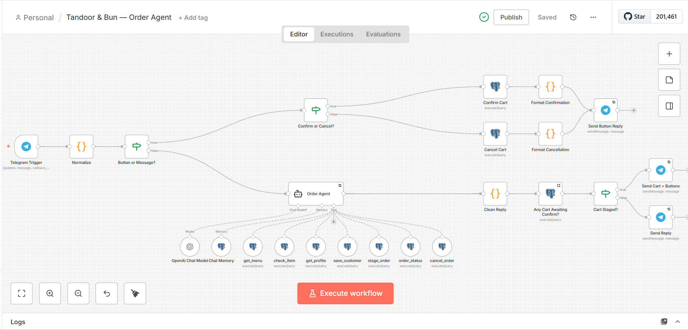
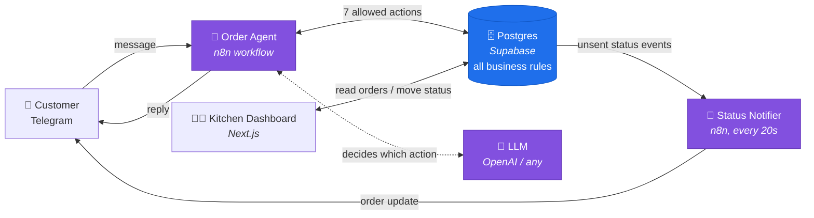

# Telegram Order Agent

**End-to-end AI order-taking for restaurants. The AI never touches money.**

Customers order through a Telegram chat in plain language — English, Roman Urdu,
or a mix. An AI agent works out what they want, checks it against the real menu,
collects their delivery details and shows them a cart to confirm with a button.
The order lands in Postgres. The kitchen sees it appear on a live board and moves
it along with one tap, and every tap automatically messages the customer.

The interesting part is not the chatbot. It is **where the rules live**: prices,
minimums, delivery fees, phone validation and order state transitions are all
enforced in the database, not in the AI's prompt. Swap the model and nothing
about correctness changes.

> The demo restaurant, **Tandoor & Bun**, is fictional. Everything about it — the
> name, menu, prices and delivery rules — is configuration. See
> [White-labelling](#white-labelling) to run it for a real shop.

---

## Screenshots

**The kitchen board.** Every ticket carries a coloured rail that fills as the
order ages against the 45-minute promise — green, amber, then red once it is
late. A glance across the room tells you what is in trouble.



| Ordering in Roman Urdu | The cart, confirmed by button |
|---|---|
|  |  |

*Typing "haan" or "ok" never places an order — only the button does, and it
carries the id of a cart that was already priced and stored.*

| Compact mode during a rush | Menu management |
|---|---|
|  |  |

**The agent workflow in n8n.** The seven database functions hanging off the agent
are everything it can do — there is no eighth, and it cannot write its own SQL.



---

## Architecture



**Five pieces. Only the database holds anything permanently.**

| Piece | Role |
|---|---|
| **Order Agent** (n8n) | Receives every Telegram message, runs the AI, sends the reply |
| **LLM** (OpenAI by default) | Decides *which* action to take. Has no direct access to anything |
| **Postgres** (Supabase) | Menu, customers, orders, carts — **and every business rule** |
| **Kitchen Dashboard** (Next.js) | Live order board, menu management, order history |
| **Status Notifier** (n8n) | Drains the "customer not yet told" queue every 20 seconds |

The Status Notifier is deliberately a **separate** workflow: editing it can never
break order-taking, and because it owns sending exclusively, a customer can never
be messaged twice about the same status change.

---

## Design philosophy

An AI can be talked out of an instruction. A database cannot.

Every rule that matters is enforced in SQL, so it holds regardless of which model
you use, how the prompt is worded, or how creatively a customer phrases things.

| Rule | Enforced by |
|---|---|
| Prices are real | `fn_stage_cart` looks up every price itself and ignores anything the AI suggests |
| Minimum order | Checked before a cart can exist |
| Delivery fee and free-delivery threshold | Calculated in the database from `shop_config` |
| Name, phone and address all required | A cart cannot be built without all three |
| Phone must be a valid mobile | Format-checked and normalised on save |
| Sold-out items cannot be ordered | Availability checked at cart build |
| Customers see only their own orders | Every lookup filtered by Telegram ID |
| **Only a button press places an order** | Orders are created from a stored cart ID, never from chat text |
| Orders follow the correct sequence | Status transitions validated server-side |
| Customers are never told twice | Notifications claimed atomically with `FOR UPDATE SKIP LOCKED` |

**Three consequences worth calling out:**

1. **The AI can only do seven things.** `get_menu`, `check_item`, `get_profile`,
   `save_customer`, `stage_order`, `order_status`, `cancel_order`. It cannot
   write its own SQL. There is no eighth action.

2. **"Yes" never places an order.** Typing *"haan"*, *"ok"* or *"confirm"* does
   nothing. Only tapping the button does, and the button carries the ID of a cart
   that was already priced and stored — so what the customer confirms is exactly
   what they were shown. Building a new cart supersedes the old one, so a stale
   button from earlier in the chat cannot be tapped into an order.

3. **The model is swappable.** This project ran on Mistral before OpenAI. No rule
   changed, because no rule ever depended on the model.

Two safety nets sit in the chat itself: a **reply cleaner** that catches internal
debugging output before it can reach a customer, and **retries** on the Telegram
hop so a network blip cannot swallow a reply.

---

## Setup

Beginner-friendly, in order. Budget about 30 minutes.

**You will need:** a Supabase account (free), a Telegram account, an n8n instance
(self-hosted or Cloud), an OpenAI API key, Node.js 20+ and Python 3.9+.

### 1. Create the database

1. Create a project at [supabase.com](https://supabase.com). Pick a region close
   to wherever your n8n runs — the two talk constantly.
2. Save the database password shown at creation. It is displayed once.
3. Open **SQL Editor** and run the files in `db/` **in numeric order**. Paste the
   contents of each, run, then move to the next:

   | File | What it does |
   |---|---|
   | `01_schema.sql` | Tables: products, customers, orders, order_items, status events. Adds indexes, `updated_at` triggers, a trigger that logs every status change, and Row Level Security with no policies so the public REST API returns nothing |
   | `02_seed_menu.sql` | 26 demo menu items with Roman Urdu aliases. Replace with your own menu later |
   | `03_functions.sql` | The seven actions the AI may call, plus `shop_config` (delivery fee, minimum order, hours) |
   | `04_cart.sql` | The staged-cart flow behind the Confirm button |
   | `05_fixes.sql` | Display-ready menu formatting; requires name, phone **and** address before an order |
   | `06_phone.sql` | Pakistani mobile validation and normalisation. **Edit this for other countries** |
   | `07_scale.sql` | Indexes for volume, including a partial index over open orders only |

4. From **Connect**, copy two connection strings and keep them handy:
   - **Session pooler** (port 5432) — for n8n and local development
   - **Transaction pooler** (port 6543) — for Vercel

> Supabase's *direct* connection is IPv6-only on the free tier. Use the poolers.

### 2. Create the Telegram bot

1. Message [@BotFather](https://t.me/BotFather) and send `/newbot`.
2. Choose a name and username.
3. Copy the token it gives you. Treat it like a password — anyone holding it
   controls the bot and can read every message sent to it.

### 3. Set up n8n

1. Get an n8n instance — [self-host](https://docs.n8n.io/hosting/) or use
   [n8n Cloud](https://n8n.io/cloud/). It must be reachable over HTTPS so
   Telegram can deliver webhooks to it.

2. In the n8n UI, create three credentials:

   | Type | Fill in |
   |---|---|
   | **Postgres** | Host, database, user and password from the Supabase *session pooler* string. Set SSL to `require` **and turn on "Ignore SSL Issues"** — Supabase signs pooler certificates with its own CA, which Node does not trust |
   | **OpenAI** | Your API key |
   | **Telegram** | Your bot token |

3. Get each credential's ID from its URL in the browser
   (`.../credentials/`**`abc123XYZ`**), then:

   ```bash
   cp .n8n_creds.example.json .n8n_creds.json
   # fill in the id and name for postgres, openAiApi and telegramApi
   ```

4. Create an n8n API key: **Settings → n8n API → Create an API key**.

5. Deploy both workflows. **Either** import the ready-made JSON —
   n8n → Workflows → *Import from File* → pick
   `n8n/workflows/order-agent.json`, then `status-notifier.json`, and select your
   credentials in the nodes that show a warning — **or** run the builders, which
   is the better path if you intend to maintain it:

   ```bash
   cp .env.example .env        # then edit it

   export N8N_URL="https://your-n8n-instance.com"
   export N8N_API_KEY="..."
   # PowerShell:  $env:N8N_URL = "..."

   python n8n/build_workflow.py    # the order agent  (24 nodes)
   python n8n/build_notifier.py    # the status notifier (4 nodes)
   ```

   Both scripts are idempotent — re-run them to apply changes. Each prints the
   workflow URL and confirms it activated.

> **Editing in the n8n UI?** Re-running these scripts rebuilds the workflow from
> the file and overwrites manual changes. Copy any UI edit back into the script.

### 4. Choose your model

The default is OpenAI, configured in `build_workflow.py`. **Any model n8n
supports works** — Anthropic, Google, Mistral, Groq, or a local model via Ollama.
No business rule depends on the model, so switching is safe: change the node type
and credential in `build_workflow.py`, or just swap the node in the n8n UI.

Models differ in *tool-calling discipline*, not correctness. A weaker model may
occasionally narrate a tool call instead of making one; the reply cleaner catches
that before the customer sees anything.

### 5. Run the dashboard

```bash
cd dashboard
npm install
cp .env.example .env.local     # then edit it
npm run dev                    # http://localhost:4400
```

Fill in `.env.local`:
- `DATABASE_URL` — session pooler string (port 5432) for local development
- `DASHBOARD_PASSWORD` — the shared team password
- `SESSION_SECRET` — `openssl rand -hex 32`

**Deploy to Vercel:**

```bash
cd dashboard
vercel
```

Then set the same variables in your Vercel project settings, but use the
**transaction pooler** string (port 6543) for `DATABASE_URL` — serverless
functions open many short-lived connections and will exhaust the session pooler.

### 6. Test it

1. Message your bot on Telegram and send `/start`. It should greet you.
2. Send `menu` — the full list should come back with real prices.
3. Order something, e.g. *"2 zinger burger aur aik coke"*.
4. It asks for your name, then phone, then address, one at a time.
5. A cart appears with **✅ Confirm** / **❌ Cancel**. Tap Confirm.
6. Open the dashboard — the order is on the board, and a chime plays.
7. Tap **Start cooking**. Within 20 seconds Telegram tells you it is cooking.

Want a populated board for a screenshot?

```bash
export DATABASE_URL="..."
python db/seed_demo_orders.py            # adds 7 tickets across the urgency range
python db/seed_demo_orders.py --clear    # removes them again
```

---

## White-labelling

Nothing about the code is specific to the demo restaurant. To run it for a real
shop, change three things — none of which require touching application code:

**1. The menu** — use the dashboard's Menu page, or edit `02_seed_menu.sql`
before first run. When adding an item, fill in the **aliases**: these are the
spellings customers actually type. `zingr`, `zingar`, `singer burger` all resolve
to *Zinger Burger*. Skip them and customers who type it differently will not be
understood.

**2. The shop rules** — one row in `shop_config`:

```sql
UPDATE shop_config SET
  name = 'Your Restaurant',
  delivery_fee = 150,
  free_delivery_over = 2500,
  min_order = 400,
  eta_minutes = '30-40'
WHERE id = 1;
```

**3. The agent's personality** — `RESTAURANT.md` describes the brand, tone and
operating rules. The system prompt lives in `build_workflow.py` (`SYSTEM_PROMPT`)
and is the one place the demo brand is named in code.

**Outside Pakistan?** Phone validation lives in `fn_normalize_pk_mobile`
(`db/06_phone.sql`) and accepts only 11-digit numbers starting `03`. Rewrite that
one function for your country — everything else is country-agnostic. Delivery
areas and currency wording live in the system prompt.

---

## Known limitations

Stated honestly, so nobody is surprised:

- **Cash on delivery only.** No online payment integration.
- **One shared password** for the whole team. No individual accounts, so the
  board cannot tell you *who* moved an order.
- **Opening hours are not enforced.** The bot will happily take an order at 4am.
- **No printed kitchen tickets.**
- **No rider tracking** beyond the "on the way" status.
- **Single restaurant.** The schema would support more; the code does not.
- **Phone validation is Pakistan-only** out of the box (see above).
- **Telegram is blocked in some countries.** The system is unaffected because
  everything that talks to Telegram runs server-side, but *testing* from such a
  connection needs a VPN.

---

## Project layout

```
├── db/                     SQL — schema, seed data, and every business rule
│   ├── 01_schema.sql       tables, indexes, triggers, RLS
│   ├── 02_seed_menu.sql    demo menu (replace with yours)
│   ├── 03_functions.sql    the 7 actions the AI may call
│   ├── 04_cart.sql         staged carts behind the Confirm button
│   ├── 05_fixes.sql        menu formatting, profile completeness
│   ├── 06_phone.sql        mobile validation + normalisation
│   ├── 07_scale.sql        indexes for volume
│   └── seed_demo_orders.py optional demo tickets for screenshots
├── n8n/
│   ├── build_workflow.py   deploys the Order Agent (source of truth)
│   ├── build_notifier.py   deploys the Status Notifier
│   ├── export_workflows.py regenerates the JSON below from those builders
│   └── workflows/          importable JSON, credentials stripped
│       ├── order-agent.json
│       └── status-notifier.json
├── dashboard/              Next.js kitchen board
│   └── src/
│       ├── app/            board, history, menu, login, API routes
│       ├── components/     ticket, toast, theme toggle
│       └── lib/            db, session, urgency, chime
├── HANDOFF.md              full plain-English system specification
├── RESTAURANT.md           demo brand and operating rules
└── PLAN.md                 design decision log
```

`HANDOFF.md` is the deepest document here — every feature, how the memory works,
and why each rule sits where it does.

---

## Contributing

Issues and pull requests welcome. See [CONTRIBUTING.md](CONTRIBUTING.md). One
rule above all: **business rules belong in the database, not the prompt.**

Security policy: [SECURITY.md](SECURITY.md).

---

## Licence

MIT — see [LICENSE](LICENSE). Use it, change it, ship it commercially.

## Credits

Built by **Shahzaib Hassan**
[LinkedIn](https://www.linkedin.com/in/shahzaib-hassan-ai-developer)
